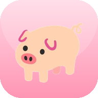

# 猪跑酷 · Pig Run
大肥鱼作品，仅用于供群友娱乐

<p align="center">
  
</p>

<p align="center">
  一个跑在浏览器里的 2D 无尽跑酷小游戏：控制小猪跳过障碍、吃蛋糕，活得越久分越高。
  <br />
  <sub>A dependency-free 2D endless runner built with Canvas 2D, WebAudio and PWA.</sub>
</p>

<p align="center">
  <code>Canvas 2D</code> · <code>Vanilla JS</code> · <code>WebAudio</code> · <code>PWA</code> · <code>Zero Build</code>
</p>

<p align="center">
  <a href="https://2856652884.github.io/pigrun/"><b>▶ 在线试玩</b></a>
  &nbsp;·&nbsp;
  <a href="#本地运行">本地运行</a>
  &nbsp;·&nbsp;
  <a href="#玩法">玩法</a>
</p>


## 特性

- **纯前端、零依赖、零构建**：没有框架、没有打包器，`index.html` 打开即玩
- **帧率无关**：120Hz 固定逻辑步长 + 累加器
- **横竖屏自适应**：竖屏使用更高的世界坐标，角色和障碍同步放大
- **跳跃手感**：可变跳跃高度 + 跳跃缓冲
- **金币系统**：随机高度、随机间隔、障碍物四周生成禁区
- **难度曲线**：横向速度随距离提升，障碍组合逐渐增多
- **合成音效**：WebAudio 实时合成，无音频文件
- **结算界面**：随机猪图、再来一次、生成分享海报
- **PWA**：可安装、离线可玩（首次访问后）
- **无后端、无账号、无追踪**

## 技术栈

| 层 | 实现 |
|---|---|
| 渲染 | Canvas 2D，单画布；横屏世界 960×420，竖屏世界高 1000 |
| 逻辑 | 原生 JS，`requestAnimationFrame` + 固定步长累加器 |
| 输入 | Pointer Events + 键盘（Space / ↑ / W） |
| 音频 | WebAudio 振荡器与噪声，运行时合成 |
| 离线 | Service Worker；页面网络优先，静态资源缓存优先 |
| 图标 | PNG 多尺寸，含 maskable |
| 分享 | Canvas 合成海报 + Web Share API，降级为下载 |

## 本地运行

```bash
git clone <repo-url>
cd <repo>
python3 -m http.server 8000
# 浏览器打开 http://localhost:8000/
```

> 直接双击 `index.html` 也能玩；但 Service Worker 只在 `localhost` 或 HTTPS 下注册。

## 操作

| 操作 | 行为 |
|---|---|
| `Space` / `↑` / `W` / 点击 / 触摸 | 跳跃 |
| 长按 | 跳得更高 |
| 「再来一次」 | 重新开始 |
| 「分享截图」 | 生成成绩海报并分享/下载 |

## 玩法

- 小猪自动向右奔跑，撞到障碍物即结束；
- 蛋糕金币在跳跃可达的高度内随机刷新；
- **只有吃金币才会得分**，存活时间本身不加分；
- 死亡后弹出结算卡片，随机显示一张 pighub 猪图。

### 计分公式

每枚金币：

```text
score = 1 + floor(surviveSeconds / 3) + min(30, floor(gapSeconds * 2))
```

- `surviveSeconds`：本局存活时长；
- `gapSeconds`：距离上一枚金币的时间；
- 间隔系数上限 30，避免长时间不吃金币后一次性刷分。

### 金币生成规则

- 自由距离间隔：`200 ~ 380` 世界像素随机；
- 障碍物左右各 `80` 像素为生成禁区；
- 禁区内的滚动距离不计入金币间隔；
- 同屏最多 `3` 枚；
- 高度范围：离地 `34 ~ 160`。

## PWA

- `manifest.json`：`display: standalone`、`orientation: any`、192/512/maskable 图标；
- `sw.js`：安装时预缓存；导航请求网络优先，离线回退到缓存；
- 安装：Android Chrome 菜单「Install app」，iOS Safari「Add to Home Screen」；
- 更新：改 `sw.js` 里的 `CACHE` 版本号，客户端下次访问会换新缓存。

## 项目结构

```text
.
├── index.html              # 游戏本体（样式 / 逻辑 / 内嵌猪图）
├── manifest.json           # PWA 清单
├── sw.js                   # Service Worker
├── icon-192.png
├── icon-512.png
├── icon-maskable-512.png
├── apple-touch-icon.png
└── README.md
```

## 可调参数

集中在 `index.html` 顶部：

| 常量 | 默认值 | 说明 |
|---|---|---|
| `GRAVITY` | `2500` | 重力 |
| `JUMP_V` | `-900` | 起跳速度 |
| `START_SPEED` / `MAX_SPEED` | `360` / `720` | 横向速度与上限 |
| `COIN_GAP_MIN` / `COIN_GAP_MAX` | `200` / `380` | 金币自由间距 |
| `COIN_KEEPOUT` | `80` | 障碍物金币禁区半宽 |
| `COIN_MAX` | `3` | 同屏金币上限 |
| `COIN_SURVIVAL_RATE` | `1/3` | 存活系数 |
| `COIN_GAP_RATE` | `2` | 间隔系数 |

竖屏参数在 `fit()` 内：世界高 `1000`、地面 `790`、速度上限 `600`。

## 兼容性

- Chrome / Edge / Firefox / Safari 现代版本；
- 依赖 Canvas 2D、WebAudio、Pointer Events；
- PWA 安装：Android Chrome、桌面 Chrome/Edge、iOS Safari（添加到主屏幕）。

## 已知限制

- 结算页的随机猪图来自 [`pighub.top`](https://pighub.top) 外链，离线或被墙时回退到 🐖；
- 该站 API 未开放 CORS，随机图列表是构建时的快照，运行时只随机取 URL、实时加载图片；
- 跨域图片无法写入 Canvas，因此分享海报不包含随机猪图；
- 无排行榜 / 账号系统，最高分只存在 `localStorage`。

## 部署

纯静态站点，把本目录上传到任意 HTTPS 静态托管即可：

```text
GitHub Pages: Settings → Pages → Deploy from a branch → main / (root)
```

## 致谢

- 游戏内猪图标来自项目自带的 `emojipig.jpg`；
- 结算页随机图来自 [pighub.top](https://pighub.top)，版权归原作者所有；
- Emoji 使用系统字体渲染。

## License

代码仅供学习与娱乐使用；第三方图片版权归原作者，请勿商用。
